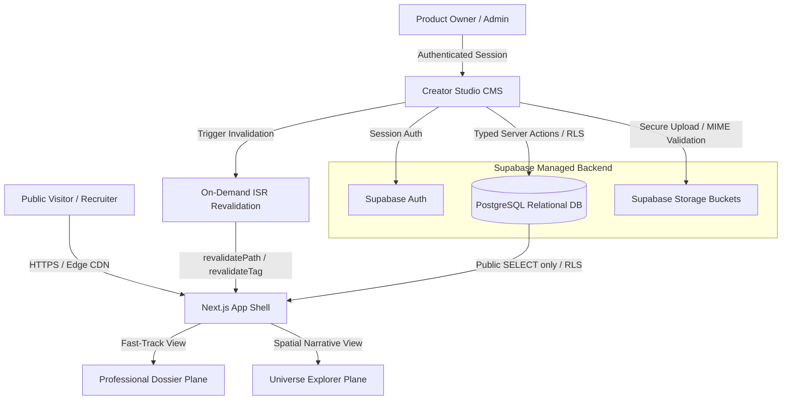

# System Architecture Specification — THE YACINEVERSE

> **Document Status:** PLANNED ARCHITECTURAL SPECIFICATION (Stage 00/01 Baseline)  
> **Target Platform:** Next.js App Router (TypeScript) + Supabase (PostgreSQL, Auth, Storage, RLS)  
> **Deployment Target:** Vercel Hobby + Supabase Free Tier  
> **Authoritative Specification:** Reflected in [docs/Product.md](file:///W:/Document/Verse/docs/Product.md)  

---

## 1. Architectural Mission & Core Paradigms

THE YACINEVERSE is a high-performance personal platform and content management system that combines:
1. **The Universe Explorer:** An interactive spatial narrative plane organizing projects, experiences, and research into thematic celestial sectors using a hybrid 2D spatial canvas with selective WebGL accents.
2. **The Professional Dossier:** A high-density, structured executive plane purpose-built for recruiters and engineering leaders to evaluate credentials, tech stacks, and source links in under 5 seconds.
3. **The Creator Studio:** A secure, custom-built administrative dashboard empowering the Product Owner to manage dynamic content, upload media, preview drafts, and trigger instant cache revalidations without modifying application code or redeploying.



---

## 2. Application Architecture & Component Boundaries

### 2.1 Next.js App Router Topology
The application is organized under `src/app/` following modern Next.js conventions:
- **`src/app/(public)/`:** Public layout containing global navigation, theme providers, audio ambient controllers, and the dual-plane view manager.
  - `/`: Entry portal supporting seamless switching between Universe Explorer and Professional Dossier via URL query (`/?view=dossier` or `/dossier`).
  - `/projects/[slug]`: In-depth project case study and architecture breakdown pages.
  - `/chronicle/[slug]`: Builder reflections, field test logs, and milestone narratives.
  - `/credentials`: High-resolution academic credential and certification viewer.
- **`src/app/(studio)/studio/`:** Protected Creator Studio administrative routes wrapped in authentication middleware and layout shells.
  - `/studio`: Executive telemetry overview and KPI metrics.
  - `/studio/projects`: Projects CRUD, tiering, and tech stack mapping.
  - `/studio/experiences`: Career timeline, roles, and achievements.
  - `/studio/skills`: Skill taxonomy, proficiencies, and icon associations.
  - `/studio/stories`: Markdown chronicle editor, excerpts, and tags.
  - `/studio/media`: Media asset library and drag-and-drop uploader.
- **`src/app/api/`:** Lightweight route handlers for webhooks, secure inquiries (Turnstile-protected), and on-demand cache revalidation.

### 2.2 Server Component vs. Client Component Boundaries
- **Server Components (RSC) by Default:** All page layouts, metadata generators, static copy, and data-fetching logic execute strictly on the server. Data is fetched directly from Supabase via typed queries with zero client bundle overhead.
- **Client Components (`"use client"`):** Confined strictly to leaf interactive components:
  - Interactive spatial canvas and pan/zoom physics.
  - Framer Motion animation wrappers and gesture listeners.
  - Viewport mode toggle and theme switchers.
  - Creator Studio form editors, rich-text inputs, and drag-and-drop uploaders.
  - Selective 3D WebGL scenes (Three.js / React Three Fiber) lazily loaded behind dynamic imports with static 2D fallbacks.

---

## 3. Relational Data Architecture (Supabase PostgreSQL)

The database schema is designed for strict relational integrity, foreign key constraints, and full Row Level Security (RLS) enforcement.

### 3.1 Core Entity Schema (Planned)
```text
┌─────────────────┐       ┌─────────────────┐       ┌─────────────────┐
│    projects     │◄─────►│ project_skills  │◄─────►│     skills      │
└─────────────────┘       └─────────────────┘       └─────────────────┘
         │
         │ 1:N
         ▼
┌─────────────────┐       ┌─────────────────┐       ┌─────────────────┐
│  project_media  │       │   experiences   │       │   credentials   │
└─────────────────┘       └─────────────────┘       └─────────────────┘
                                   │
                                   │ 1:N
                                   ▼
┌─────────────────┐       ┌─────────────────┐       ┌─────────────────┐
│     stories     │       │   inquiries     │       │   audit_logs    │
└─────────────────┘       └─────────────────┘       └─────────────────┘
```

- **`projects`:** `id (uuid)`, `slug (text, unique)`, `title (text)`, `tagline (text)`, `summary (text)`, `problem_statement (text)`, `architecture_breakdown (text)`, `tier (enum: flagship, highlight, lab)`, `sector (enum: ai_systems, enterprise, healthcare, agrotech, experiments)`, `github_url (text)`, `live_url (text)`, `status (enum: draft, published, archived)`, `published_at (timestamptz)`, `created_at`, `updated_at`.
- **`experiences`:** `id (uuid)`, `company (text)`, `role (text)`, `location (text)`, `start_date (date)`, `end_date (date, nullable)`, `is_current (bool)`, `highlights (jsonb)`, `order_index (int)`.
- **`skills`:** `id (uuid)`, `name (text)`, `category (enum: languages, frontend, backend, ai_ml, systems_devops, databases)`, `icon_key (text)`, `proficiency_level (int)`, `is_featured (bool)`.
- **`stories`:** `id (uuid)`, `slug (text, unique)`, `title (text)`, `excerpt (text)`, `body_markdown (text)`, `cover_image_url (text)`, `read_time_minutes (int)`, `status (enum: draft, published)`, `published_at (timestamptz)`.
- **`credentials`:** `id (uuid)`, `title (text)`, `issuer (text)`, `issue_date (date)`, `credential_type (enum: degree, certification, transcript)`, `image_url (text)`, `verification_url (text)`.
- **`media_assets`:** `id (uuid)`, `bucket_id (text)`, `file_path (text)`, `mime_type (text)`, `file_size_bytes (bigint)`, `alt_text (text)`, `width (int)`, `height (int)`.
- **`inquiries`:** `id (uuid)`, `sender_name (text)`, `sender_email (text)`, `subject (text)`, `message (text)`, `is_read (bool)`, `ip_hash (text)`, `created_at (timestamptz)`.

---

## 4. Security & Authorization Architecture

### 4.1 Row Level Security (RLS) Policy Model
Row Level Security is enabled on 100% of tables:
- **Public `anon` Role:**
  - `SELECT`: Permitted ONLY where `status = 'published'`. Private drafts, internal notes, and administrative tables return empty.
  - `INSERT / UPDATE / DELETE`: Strictly denied on all core content tables.
- **Authenticated Owner Role (`authenticated` with UID check):**
  - Full CRUD permissions on all tables where `auth.uid() = [OWNER_UID]`.
- **Inquiry Ingestion:**
  - Public visitors submit inquiries via Next.js Server Actions with Cloudflare Turnstile token validation and rate limiting. The server action inserts via a restricted service client, preventing direct client-side table writes.

### 4.2 Storage Security
- **Bucket `public-assets`:** Public read access with aggressive CDN caching (`Cache-Control: public, max-age=31536000, immutable`). Uploads restricted to authenticated owner with magic-byte MIME type allowlists.
- **Bucket `private-documents`:** Restricted read/write access for authenticated owner (unredacted documents, backup archives).

---

## 5. Performance, Rendering & Free-Tier Operational Strategy

### 5.1 Hybrid Rendering & On-Demand ISR
- Static generation (`force-static`) applied to high-traffic public views (Dossier, Projects index, Credentials).
- On-Demand Incremental Static Regeneration (ISR) triggered automatically whenever the owner updates content in Creator Studio:
  ```typescript
  // Triggered on content publication
  revalidatePath('/projects/[slug]', 'page');
  revalidatePath('/', 'page');
  revalidateTag('projects-feed');
  ```
- Eliminates dynamic database query waterfalls on public visits while guaranteeing immediate content updates without full rebuilds.

### 5.2 60fps Motion & 3D Fallback Architecture
- **Layer 1 (2D CSS & SVG):** Modern hardware-accelerated CSS transforms (`translate3d`, `scale`) for 90% of spatial navigation.
- **Layer 2 (Canvas / Selective Three.js):** Lightweight WebGL starfield and interactive node graph loaded lazily.
- **Accessibility Fallback:** `window.matchMedia('(prefers-reduced-motion: reduce)')` immediately disengages WebGL camera movements and continuous animations, rendering clean, instant static views.
- **GPU Context Loss Handling:** Automatic graceful degradation to 2D canvas if WebGL initialization fails or encounters context loss on low-tier mobile devices.

### 5.3 Free-Tier Quota Guardrails
- Initial JavaScript bundle budget: $< 200KB$ gzipped.
- Zero raw uncompressed GIFs or bloated JSON animations.
- Heavy videos streamed externally (YouTube/Vimeo embeds); only optimized WebP/AVIF graphics stored in Supabase Storage.
- Database queries indexed on foreign keys and slugs to maintain sub-10ms query times.
