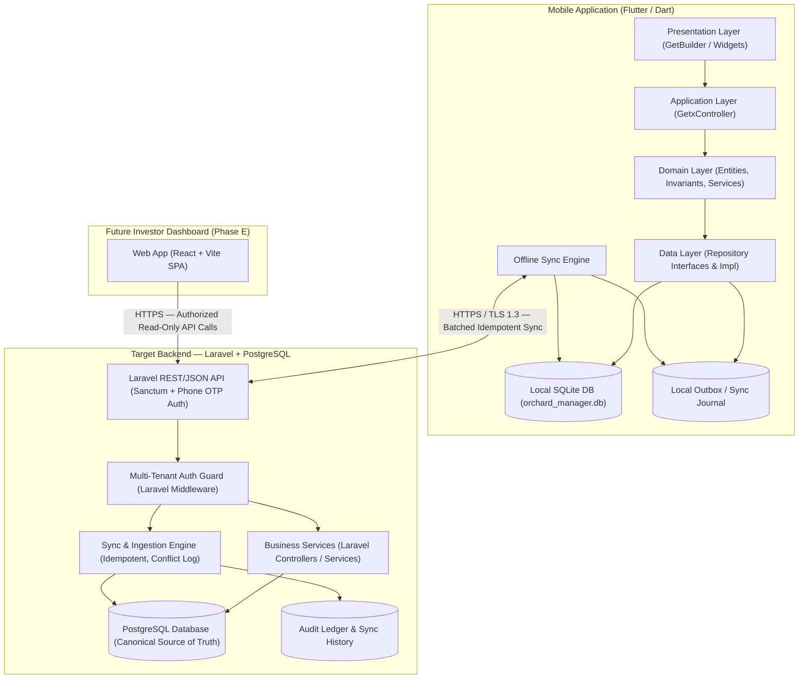

# System Architecture — Farmer ERP

## 1. Verified Prototype Architecture Baseline
This section documents the verified architecture of the existing application in the repository (Stage 00/01 baseline):

- **Workspace Organization:** 
  - Mobile application source resides entirely within `mobile/`.
  - Future investor dashboard space is reserved at root `web/` (`web/README.md`).
- **Client Application:** Flutter (v3.38.4 / Dart 3.10.3) located at `mobile/lib/main.dart`.
- **State Management & Presentation:** 
  - GetX controllers (`GetxController`) implementing manual `update()`.
  - UI screens implemented as `StatelessWidget` wrapped in `GetBuilder`.
  - Deviations documented: `AuthGate` uses `StatefulWidget` / `setState()`; `LicenseService` uses `RxBool` (`.obs`).
- **Local Persistence:** 
  - SQLite database (`orchard_manager.db` at schema version 3) managed by `DatabaseService`.
  - Direct raw SQL execution inside controllers (`rawQuery`, `rawInsert`, `rawUpdate`).
  - Secondary storage via `SharedPreferences` for preferences and legacy debtor store (`debtors_v1`).
  - Secure storage via `FlutterSecureStorage` for PIN hash (`user_pin_hash`).
- **Remote Services:** 
  - Firebase Firestore (`fasila-767f3`) used solely for device license checks (`LicenseService`) and app upgrade checks (`SettingsService`).
- **Synchronization & Backend:** 
  - 0% implemented. No cloud backend, API, offline queue, or sync protocol exists.

> [!CAUTION]
> The current prototype architecture contains critical defects (AUD-001 offline lockout, AUD-002 duplicate debtor storage, AUD-003 floating-point money, and 47 static analysis compile/linter errors in unmaintained screens). It is a discovery baseline, not the approved target architecture.

---

## 2. Confirmed Product Direction & Target Architecture Principles
Based on confirmed Product Owner decisions (ADR-001 through ADR-014):

> [!NOTE]
> **ADR Supersession Notice (2026-10-22):** ADR-003 (Supabase) has been **superseded** by ADR-012 — the backend uses Laravel + PostgreSQL. ADR-005 (NestJS) has been **superseded** by ADR-013 — Laravel is the selected backend. ADR-004 (React + Vite) remains an accepted direction but is under review per ADR-014. Technology versions are specified in ADR-011 (pending PO approval). See `.agent/DECISIONS.md` for full details.

1. **Incremental Modularization (ADR-001):**
   - No rewrite of the Flutter application.
   - Incrementally introduce a feature-first modular architecture (presentation, application, domain, data layers).
   - Adopt modular architecture, explicit repository interfaces, and dependency injection adapted to Flutter.
   - Preserve existing working UI, Arabic RTL typography, and farm operator workflows.

2. **Offline-First Persistence (ADR-002):**
   - SQLite is the primary local persistence engine for all operational mobile data.
   - All mutations write durably to local SQLite before any network activity.
   - Introduce client-generated UUIDs (UUID v4/v7) for all operational entities to prevent cross-device ID collisions.

3. **Laravel + PostgreSQL Backend (ADR-012, supersedes ADR-003):**
   - Laravel modular monolith (version per ADR-011) is the production backend.
   - Multi-tenant isolation enforced via Laravel middleware and PostgreSQL query scoping.
   - Server-side business logic implemented as Laravel controllers/services.
   - **Supabase is permanently rejected** — see ADR-012 for rationale.

4. **Investor Web Dashboard (ADR-014, updates ADR-004):**
   - Greenfield desktop-first web application residing in root `web/`.
   - Read-only consolidated and per-farm reporting for farm owners/investors.
   - Technology: **React + Vite** single-page application (confirmed Product Owner decision, ADR-004/ADR-014) communicating strictly via documented Laravel REST/JSON API endpoints.
   - Consumes the canonical Laravel REST/JSON API.

5. **Backend Framework (ADR-013, supersedes ADR-005):**
   - Laravel is the selected backend framework for all phases.
   - NestJS evaluation pathway is superseded.
   - The Flutter mobile architecture interfaces with standard REST/JSON API via repository and data source interfaces.

6. **Ownership, Farm Scoping & Permissions (ADR-006, ADR-007):**
   - Investor account owns farms; users gain access via farm memberships.
   - Users may belong to multiple farms with distinct, farm-scoped permissions.
   - Built-in roles initially (`owner`, `manager`, `viewer`); design permission boundaries so configurable roles can be introduced without UI rewrites.
   - Server-enforced authorization; client-side UI checks are convenience only.

7. **Financial & Data Integrity (ADR-008):**
   - Immutable audit trail for financial transactions, wage adjustments, and debt settlements.
   - Monetary values represented with integer precision (cents/millimes) to eliminate IEEE-754 floating-point inaccuracies.
   - Wage calculation rates snapshotted at the time of log entry.

8. **Offline Synchronization & Conflict Management (ADR-009):**
   - Transactional outbox / change journal in local SQLite.
   - Idempotent upload operations with stable operation IDs.
   - Additive operations append monotonically; state mutations check entity versions; unsafe conflicts are flagged for user review rather than silently overwritten.

9. **Commercial Entitlements & Activation (ADR-010):**
   - Account activation and farm capacity limits enforced on the trusted backend.
   - Offline grace periods with locally cached, signed activation tokens; offline boots never wipe local data or lock out field workers.

10. **Candidate Deployment Target — Hostinger VPS (D0 Assessment):**
    - Evaluated as a potential deployment target for the Laravel REST API and PostgreSQL database.
    - Deployment approach: Containerized via Docker & Docker Compose on Ubuntu 24.04 LTS (minimum KVM 2 / 2 vCPU / 8 GB RAM recommended).
    - Status: Feasibility confirmed; production purchase, provisioning, domain, and deployment approval remain explicitly pending Product Owner decision.
---

## 3. High-Level Target Architecture Topology

> [!NOTE]
> This diagram represents the **intended target architecture** — none of the backend or sync components shown exist in code yet. The prototype baseline (Section 1) is the current implementation state. All backend work is strictly blocked pending Product Owner approval of Phase D.

> [!CAUTION]
> **No direct client access to PostgreSQL.** All data access — from both Flutter mobile and the future web dashboard — goes exclusively through the Laravel REST/JSON API layer. The former Supabase PostgREST / direct-PG access pattern (ADR-003, now superseded by ADR-012) is permanently rejected.

---

## 4. Unresolved Technical Design Decisions (Phase D Investigation)

> [!NOTE]
> These decisions were previously labelled "Phase B." They remain open and must be resolved before or during Phase D implementation. None are implemented in the current codebase.

- **BD-001:** Exact SQLite schema migration sequence (integer autoincrement IDs to UUIDs v7); tombstone schema for offline deletions.
- **BD-002:** Financial integer scale confirmed as **1 DZD = 100 Centimes** (integer minor units). Distinction from millimes must be documented in the canonical schema before D2.
- **BD-003:** ~~Supabase PostgreSQL table schema, foreign keys, and RLS policy definitions~~ → **SUPERSEDED (ADR-012).** Now: Laravel migration DDL for core entities (`farms`, `projects`, `employees`, `work_logs`, `expenses`, `incomes`, `debtors`, `payments`, `deductions`), PostgreSQL foreign key constraints, and Laravel multi-tenancy middleware scoping rules.
- **BD-004:** Sync engine outbox payload schema, idempotent batching strategy, and cursor pagination for pull sync.
- **BD-005:** Domain-by-domain conflict detection rules (additive vs. state-mutation entities) and conflict review UI/UX.
- **BD-006:** Cryptographic signing format and revocation policy for offline license grace tokens.
- **BD-007:** Integer-ID-to-UUID migration strategy for existing SQLite v4 prototype data during Phase F legacy cutover.
